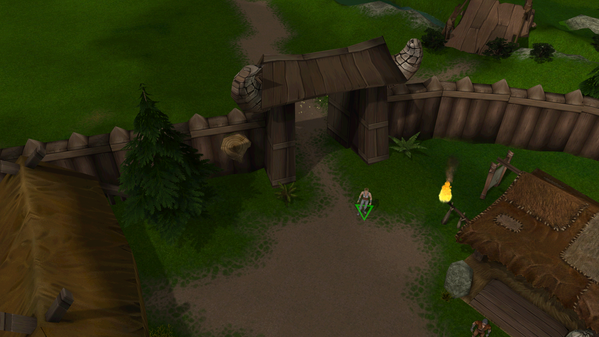
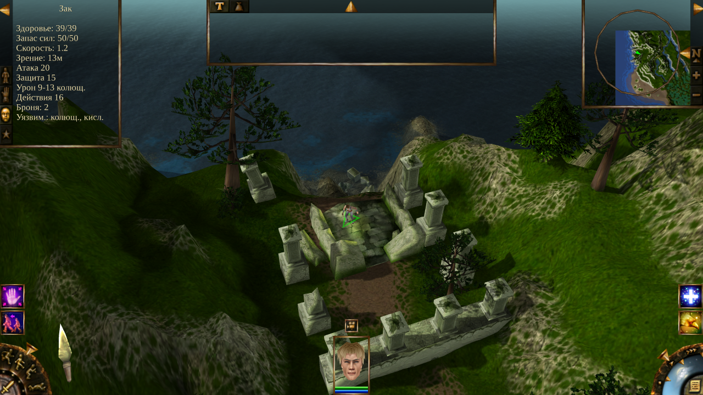
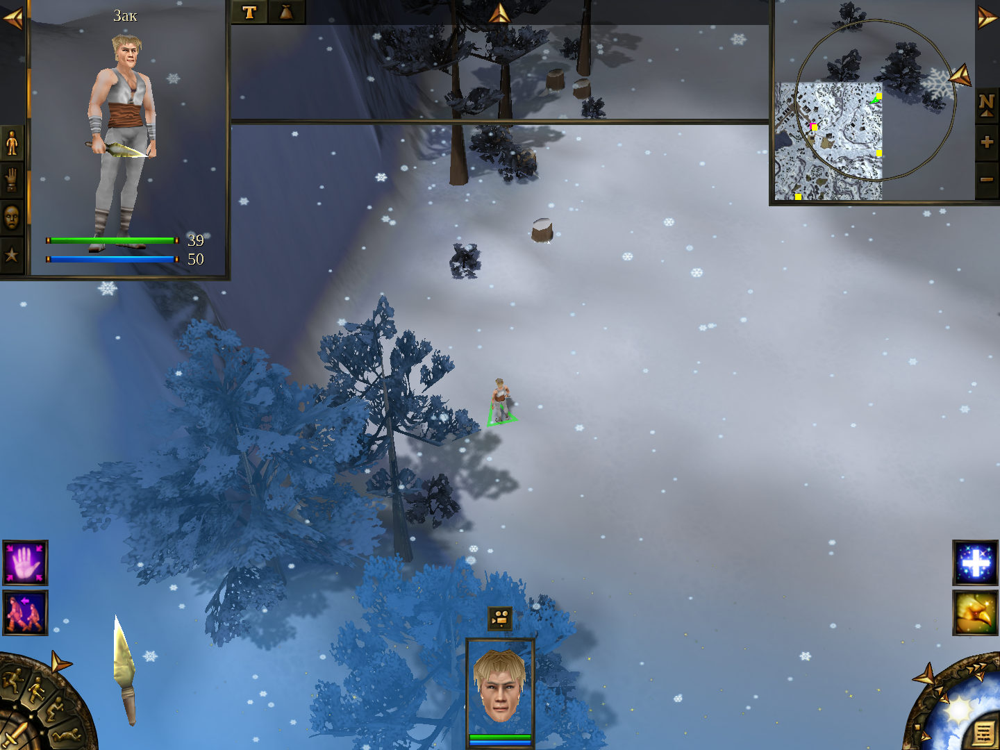
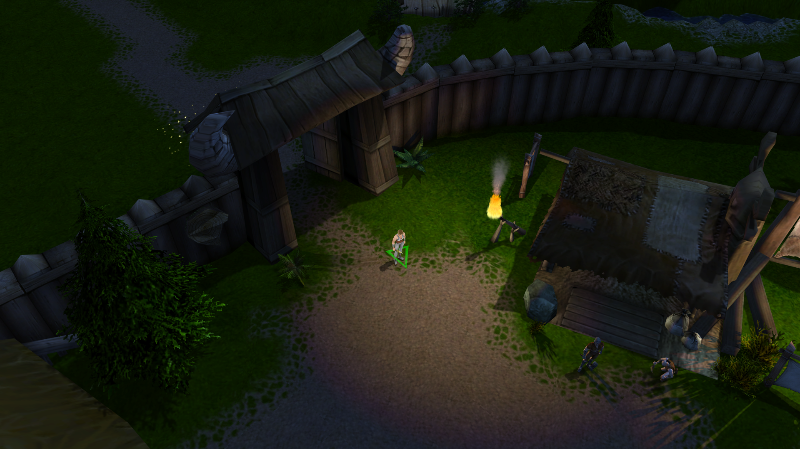
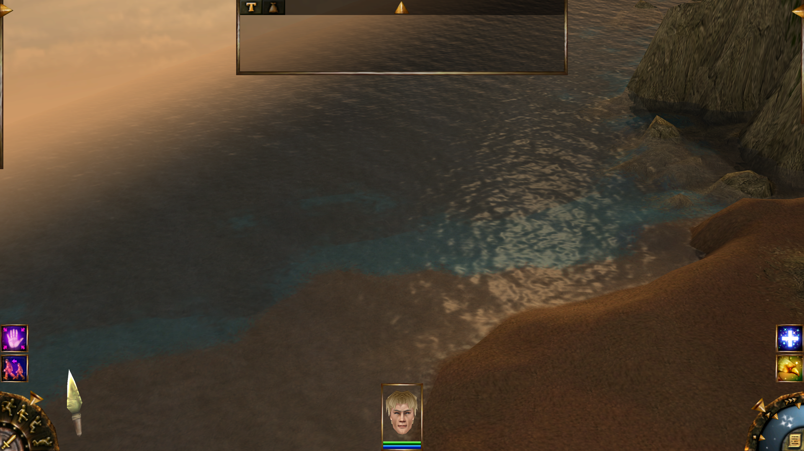
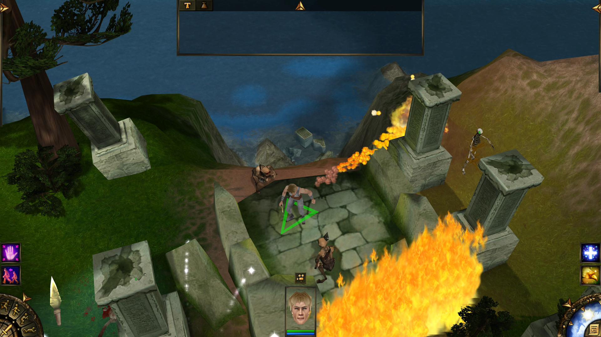
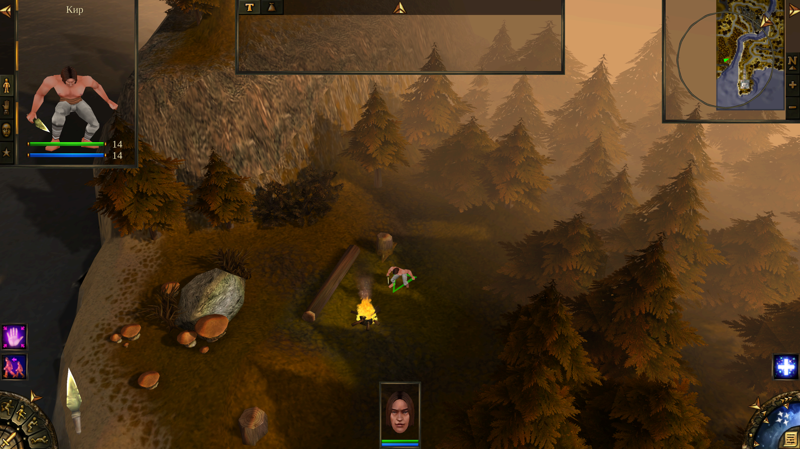
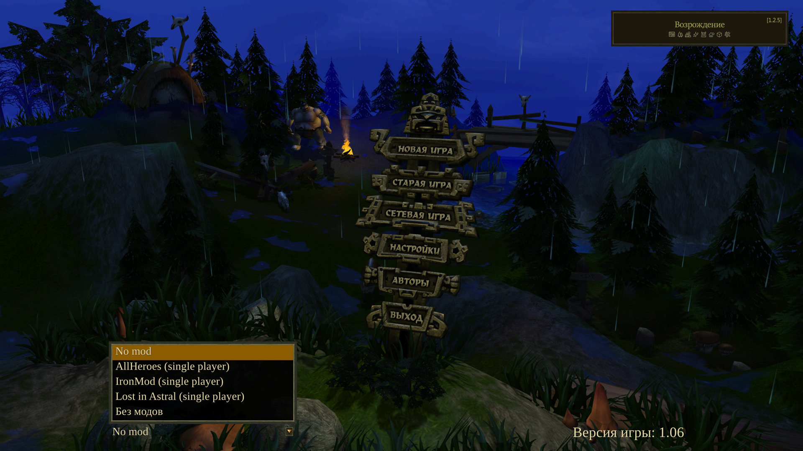
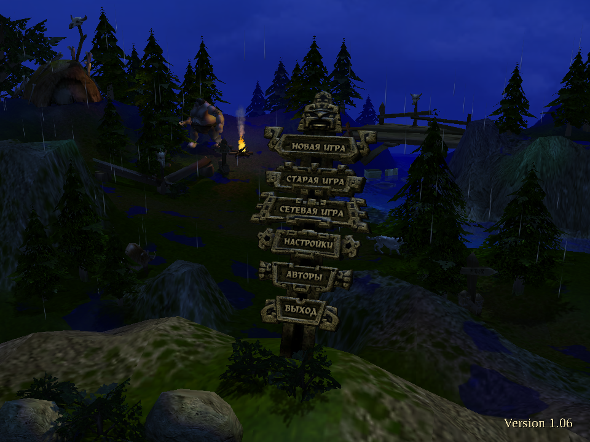

# Evil Islands (Проклятые Земли) rebuild

Readable C++ source for the Russian `game.exe` 1.06 of Evil Islands, rebuilt with modern C++ for 64-bit Windows, Linux and macOS. The goal is
identical game behaviour, not identical bytes: the same world, saves and network play as the original, with a new
renderer and the Rebirth edition's fixes on top.

The product is the standalone game: `ei-rebuild.exe`, one exe that holds all of the game's code. Dropped into an
installed game's folder (GOG or Rebirth) it plays from there, with no other file of ours; it needs no `game.exe`. The original `game.exe` was the test
harness's reference until the goldens became our own (H40, git tag `original-oracle`).

## Status

The whole game runs on the rebuilt code and is playable in single player and over the network, on Windows, Linux and
macOS. The test suite (about 200 scenarios on the GOG data and 110 on Rebirth's) compares every run's world state and save
files with goldens that were the same as the original game's runs when the harness stopped running it.

## Screenshots

Taken at 3840x2160 with 8x MSAA and 16x anisotropic filtering by the harness's `screenshots_*` scenarios, shown at
1920x1080.

| | |
|---|---|
|  |  |
| Rebirth data: the town by day with the new renderer's sun shadows | GOG data: the widescreen HUD, the unit panel's info page open |
|  |  |
| Rebirth data: snowfall, with the trees' shadows on the snow | GOG data: the town at night with torch light |
|  |  |
| GOG data: the sea at sunset, the sky and the low sun reflected in the waves | Rebirth data: a fight with a fire wall, fireballs and lightning |
|  |  |
| Rebirth data: the Lost in Astral mod at sunset | Rebirth data: the main menu's list of mods |



The main menu at night in the rain (GOG data).

## What you get

- **One exe, no installer.** Drop `ei-rebuild.exe` into a GOG or Rebirth install and start it. It needs no
  `game.exe`, no `binkw32.dll`, no `mss32.dll` and no registry entries.
- **Your saves and multiplayer still work.** Saves are in the original's format, so your old saves load. Hosting and joining
  network games work as before.
- **A 64-bit exe** with the original's behaviour.
- **A new renderer** on Direct3D 12, Vulkan or Metal (SDL3's GPU API): per-pixel lighting, soft sun and moon shadows, MSAA and anisotropic filtering,
  a smooth camera, vsync, and an optional performance overlay.
- **A better-looking world:** water with waves, sky reflections, depth colour and soft shores (green swamps
  with muddy rims), ambient occlusion, cloud shadows drifting over the ground, and weather that touches surfaces: rain
  ripples on water, wet ground, objects and characters, snow cover, and dry spots under roofs.
- **Smoother characters:** animations blend from one state into the next (idle, walk, run, attack, hit, death).
- **Widescreen** at any resolution, with the interface scaled to the window. The options window picks the resolution from
  the display's own sizes; full screen never changes the display mode (the picture is scaled to the monitor), and a
  window can be resized freely.
- **Graphics options in the game's own options window:** full screen or a window, the resolution, antialiasing,
  anisotropic filtering, vsync and the performance overlay, applied at once and saved to `ei_settings.ini`.
- **The cursor stays inside the window** while the camera pans at the window's edges (battle, village and
  briefing screens), and is free in the menus.
- **Mods:** Rebirth's mods in `starter\Mods`, Lost in Astral among them, play from our exe. Pick one
  from the main menu's list and the game switches to it in place, with no restart; each mod keeps its own saves.
- **The Rebirth edition's fixes built in**, including its bug fixes and options, on both the GOG and Rebirth data.
- **A new interface layer** drawn by the renderer, with sharp text at any size.
- **New sound and video code:** sound plays through SDL3 with our own mixer, caves get their reverb back, and the game's
  Bink movies play through its own decoder.
- **SDL3 for the window and input:** the window, keyboard, mouse, clipboard and sound device run on SDL3, linked into
  the exe.
- **Unicode throughout.** Names and text are UTF-8 inside the game; saves and the network stay in the original's
  encoding.

## Differences from the original

- Settings live in `ei_settings.ini` beside the exe, a plain ini (`[video]`, `FullScreen = true`), not in the
  registry; one file serves both installs.
- Graphics differ: the lighting, shadows, water, weather and texture filtering are new, so screenshots won't match the
  original's.
- Sound volume, panning and cave reverb follow our own curves, since the original's sound library is not used.
- Some MP3 voice lines start up to about 90 ms earlier than with the original's decoder.
- Rebirth's bug fixes and its widescreen layout are always on, even on GOG data.
- A loaded save, or a zone entered again, keeps the rain it had; the original always came back with a clear sky.
- Unarmed units and crossbow holders play the pick-up animation when they search a body; the original played none.
- A click picks the object drawn under the cursor; the original picked the one whose centre was nearest, so a lever
  standing on a big platform could be unclickable from some camera angles.

The source is readable modern C++: every function is rewritten from the original, with no leftover MFC or STLport.
Lua mission scripting is planned (`docs/notes/lua-scripting.md`). The work queue is `docs/tickets/` (one file per ticket; `python tools/tickets.py list` or the ticket board).

## Requirements

- Windows 10 or later.
- The VS 2022 Build Tools with MSVC 14.43 for x64, and CMake and Ninja from the same install. `build.cmd` looks in
  `E:\bin\vs\buildtools`; set `EI_VSROOT` to your Build Tools folder if it is elsewhere.
- Python 3 (the build runs checks written in Python).
- An installed copy of the game for its data:
  - the GOG release (`EI_GAME_VANILLA`, default `F:\games\EvilIslands`), and/or
  - the Rebirth edition (`EI_GAME_REBIRTH`, default `F:\games\Evil Islands (Rebirth)`).

  The game keeps its settings and log in the folder it runs from; the saves go to the install's `saves`.

## Build

```
build.cmd release        the game: build\release\ei-rebuild.exe
build.cmd verify         the game with the test harness linked in, into build\verify (what the tests run)
```

The build also runs the source checks (`tools/check_*.py`, the generated files' freshness); none reads `game.exe`.

Linux and macOS build from the same CMakeLists.txt ([the Linux notes](docs/notes/linux.md),
[the macOS notes](docs/notes/macos.md): SDL3, POSIX, SDL_GPU's Vulkan or Metal driver). The GitHub releases hold
all three: `ei-rebuild.exe` (alone, or in a zip), the Linux archive and a universal macOS app, which is not notarised:
clear its quarantine flag once (`xattr -dr com.apple.quarantine ei-rebuild.app ei-convert`, or Control-click > Open),
then open it inside the game folder or choose the folder when it asks (the zip's README.txt). Each archive also holds
`ei-convert` and the `examples` folder: `ei-convert --example-mod "<game folder>"` makes the example mod of
[the modding guide](docs/modding.md) from your own install.

## Play

Copy `build\release\ei-rebuild.exe` (or the exe from the GitHub release) into the game's folder, a GOG or Rebirth
install, and start it there. It writes `ei_settings.ini` beside itself with the defaults (borderless full screen at the
desktop's size, every graphics setting at its best). Rebirth's fixes and additions are always on, so a GOG and a
Rebirth install run the same code; only the folder's data differs. Rebirth's multiplayer player count and pause mode
are the host's choices on the create-server screen.
It writes into that folder (settings, saves, `ei-rebuild.log`), so use a copy of the install if you want the original
kept as it is. The registry is never read.

The render quality (MSAA samples, anisotropy), the performance overlay and vsync are set in the settings file's
`[renderer]` section (`docs/settings.md`; `docs/notes/renderer.md` sections 11 and 15).

To start it on an install from elsewhere, set `EI_GAME_ROOT` to the game folder and run the exe (arguments for the
game follow `--`).

To record a session of your own play as a scenario: `harness.cmd record <name> [vanilla|rebirth]` (builds the test
build and plays it with your input recorded; `docs/notes/harness.md`, "Recorded play").

### Mods

On a Rebirth install the main menu has a mod list at its bottom left: "No mod" and every folder in `starter\Mods` with
a `config.reg`, titled by the mod's own name. Picking one switches the game to it at once and stores the choice in
`ei_settings.ini` (`[game] Mod = starter\Mods\LostInAstral`, the mod's folder relative to the exe, or a full path;
empty for no mod). A mod's files stand over the game's (its archives are combined with the game's), and its saves go
to `saves\<mod>\`, apart from the plain game's. Lost in Astral needs the Rebirth edition's data: it uses models and
textures Rebirth added to the game's own archives (27 new entries, e.g. the `stst4disc` model of its main menu), so on
a GOG install it stops at its first menu. It plays through to its ending (its cut-scene bases, later quests and
credits are scenarios). How it works: `docs/notes/mods.md`.

Making mods: [docs/modding.md](docs/modding.md), the modder's guide. Besides the original formats a mod can be made of
loose common files (TOML records and texts, PNG textures and map layers, glTF models and animations), and `ei-convert`
exports the game's own data in those formats. `examples/example_mod` is a small mod made that way.

## Test

```
harness.cmd tests\scenarios\smoke.txt     one scenario on our game, exit code 0 when it passes
python tools\run_all.py --golden          every scenario, 16 games at once, compared with the goldens
```

Scenarios are text files in `tests/scenarios/`. The harness runs the game hidden on a virtual clock, so a scenario
repeats exactly, and compares the world state with its goldens (`tests/golden/`): our game's own runs (those that existed when the harness
stopped running the original game, H40, were the same as its runs). How to write scenarios and what a run does:
`docs/notes/harness.md`; how changes are checked: `docs/notes/standalone-verification.md`.

On GitHub, `suites.yml` runs the suites on a self-hosted Windows runner that has the game installed, and
`suites-linux.yml` runs them on GitHub's Linux runners (eight shards on Mesa's
software Vulkan, with a stub of the game data from a private repository), less the render_*, net_* and camera_*
scenarios and a few more that a CPU renderer cannot finish in time (`LINUX_SKIP`; `docs/notes/linux.md`, The CI job).
`suites-windows.yml` and `suites-macos.yml` are smoke runs (the builds and a short scenario list).

The test tools find the installs by `EI_GAME_VANILLA`, `EI_GAME_REBIRTH`, default the `F:\games` paths
above; `tools/run_all.py` install_dir); the few tools that read game.exe's file read the
installs' (`tools/exe_path.py`).

## Layout

- `src/engine/` the engine the game runs on: data and archives, models, the scene, core objects, the mods' file layers,
  the particle core (`docs/notes/file-layout.md`, "The engine library").
- `src/game/` the game code.
- `src/lib/` small shared pieces: the CRT parts behaviour depends on (formatting, the game CRT's pow / acos / asin / hypot), file and text helpers, byte copies.
- `src/render/` the renderer (SDL3's GPU API through `src/render/gpu.h`; `docs/notes/renderer.md`).
- `src/platform/` the window, input, files and threads on SDL3 (`docs/notes/platform.md`); `src/audio/` the mixer;
  `src/video/` the movie player; `src/main.cpp` the exe's start.
- `tests/verify/` the harness; `tests/unit/` checks of our code without the game; `tests/port/` the Linux and macOS
  checks; `tests/scenarios/` and their goldens in `tests/golden/`.
- `tools/` the build checks, test runner, ticket and progress tools; `tools/convert/` ei-convert.
- `examples/` the modding guide's example mod (`docs/modding.md`).
- `docs/` how to work on the code (`worker-brief.md`, `rewrite-guide.md`, `comment-guide.md`), the tickets, and one
  note per area in `docs/notes/` (index: `docs/notes/README.md`).

## License

The original work in this repository (the tools, the test harness, the renderer and the rebuilt source as written
here) is under the MIT license (`LICENSE`). Libraries in `third_party/` keep their own licenses. The interface fonts
(`third_party/fonts`, Liberation, SIL Open Font License 1.1) are built into the executable; every build writes
`third_party_notices.txt` beside it with the third-party licences.

Evil Islands (Проклятые Земли) and its data are the property of their rights holders (Nival). This repository holds no
game files: no `game.exe`, no resources, no music or video. To build or play it you need your own copy of the game.
The Rebirth edition's fixes are reimplemented from its behaviour; the Rebirth edition belongs to its authors.
